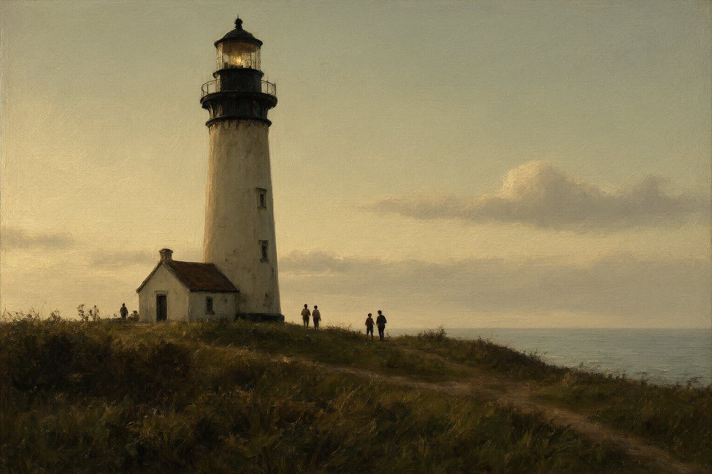
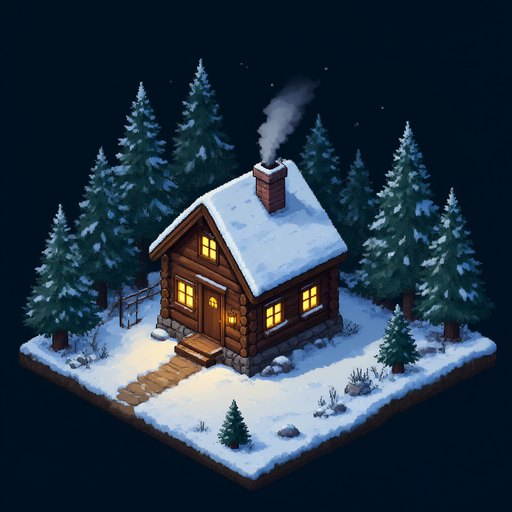
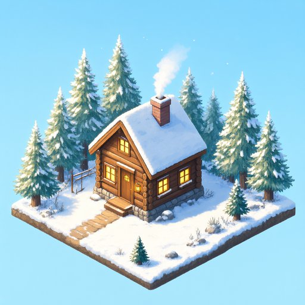

# ex-nihilo

Pictures **out of nothing**, in Common Lisp: Qwen-Image-2.1-Turbo's prompt
encoder, diffusion transformer and decoder, run by SBCL and a few CUDA or
Metal kernels -- no Python, no PyTorch. A sibling of
[illatio](https://github.com/modus-lisp/illatio), on its GGUF reader, its
CUDA and Metal layers and its devices.

*Ex nihilo*, Latin: "out of nothing" -- a picture from pure noise.

This one, exactly (same prompt, same seed, same picture):

    curl -s localhost:9940/v1/images/generations \
      -d '{"prompt": "a lighthouse at dusk, oil painting", "size": "1536x1024", "seed": 7}'

## A few more

Each 1024x1024, eight steps, about 11 seconds on an RTX 3090; the prompt
under each is all it was given.

| | | |
|:---:|:---:|:---:|
|  |  |  |
| *a red fox curled up asleep in fresh snow, early morning light, telephoto wildlife photograph, shallow depth of field* | *a hand-painted wooden sign outside a little bakery reading 'FRESH BREAD' above 'OPEN DAILY', warm morning sunlight, photograph* | *a watercolor painting of a quiet Venice canal with gondolas, loose wet washes, white paper showing through* |
|  |  |  |
| *flat vector illustration of an astronaut tending a vegetable garden on the moon, the Earth rising in the black sky, limited pastel palette* | *isometric pixel art of a tiny cozy log cabin in a snowy pine forest at night, warm glowing windows, smoke from the chimney* | *a steaming cup of coffee beside an open notebook and a fountain pen on a wooden cafe table, rainy window behind, 35mm film photograph* |

**Words come out spelled right.** Quote the text the picture must hold, as
the bakery's prompt does.

**Cut-outs, too.** The decoder makes RGBA: ask for `"background":
"transparent"` and say so in the prompt (*a cheerful little cartoon robot
waving, sticker style with a thick white outline, isolated on a transparent
background*), and the picture comes with its alpha -- this robot has no
background at all.

 

## Editing

Give it a picture and say what to change. The prompt encoder sees the picture
through Qwen3-VL's vision tower, and the DiT gets it as a latent ahead of the
one it is making, so what you don't mention stays put.

| | | | |
|:---:|:---:|:---:|:---:|
|  |  |  |  |
|  |  |  |  |
| *Change the sign to read 'FRESH PIE' above 'OPEN DAILY'.* | *Put a small red knitted scarf around the fox's neck.* | *Replace the cup of coffee with a tall glass of orange juice.* | *Make it a sunny winter afternoon, the sky blue.* |

The pictures above, edited; the prompt under each is all it was given (seed 1).

## Repainting

With `strength`, a picture is used another way: it is encoded, noised part of
the way, and the steps run from there, the prompt describing the whole result.
`strength` says how far it may go.

| source | 0.6 | 0.8 | 0.9 |
|:---:|:---:|:---:|:---:|
|  |  |  |  |

The lighthouse above, with *a lighthouse at night in a snowstorm, its beam
cutting through the falling snow, oil painting*: at 0.6 the lamp is lit, at
0.8 the snow comes, at 0.9 it is night and the tower redrawn.

It is best at light, weather, season and mood, with the composition kept; a
photograph turned into another medium wants a high strength (0.9 and up).
For anything precise, edit instead.

## How it works

    prompt (and a picture to edit, through the vision tower)
       ──► Qwen3-VL-8B's text model (Q8_0) ──► its last states, kept per prompt
                                                        │
    noise (beside the picture to edit, as a latent) ──► DiT: 7B, 32 blocks, 8 Euler steps
                                                        │
                                              VAE decoder (Wan 2.2's) ──► RGBA PNG

Qwen-Image-2.1-Turbo is a flow-matching model distilled to eight steps with
no classifier-free guidance, so a picture is eight passes of the DiT and one
of the decoder. The encoder's states for a prompt are computed once and kept;
the DiT's products and attention run on the tensor cores; the VAE's decoder
and encoder share their building blocks. [docs/design.md](docs/design.md) is
the model read closely, [docs/research.md](docs/research.md) why this model,
and `inspect/` holds the numpy references the kernels were checked against.

On an RTX 3090, the encoder on a second card: 1024x1024 in about 11 s (9.5 s
of steps, 1.5 s of decoding), 1536x1024 in about 22 s. A picture from a
picture takes half a second more to encode, and fewer steps. An edit at a
megapixel takes about 20 s, the picture's tokens doubling the DiT's sequence.

## Running it

SBCL on Linux and an NVIDIA GPU: the DiT and decoder on a 24 GB card, the
prompt encoder on a second (or on the CPU, slower), illatio checked out
beside this directory. The weights, about 18 GB:

    mkdir -p /mnt/ollama/exn && cd /mnt/ollama/exn
    curl -L -o vae.safetensors https://huggingface.co/Comfy-Org/Qwen-Image-2.1/resolve/main/vae/qwen_image_2.1_vae_bf16.safetensors
    curl -L -o dit-q8_0.gguf   https://huggingface.co/unsloth/Qwen-Image-2.1-Turbo-GGUF/resolve/main/qwen-image-2.1-turbo-Q8_0.gguf
    curl -L -o te-q8_0.gguf    https://huggingface.co/Qwen/Qwen3-VL-8B-Instruct-GGUF/resolve/main/Qwen3VL-8B-Instruct-Q8_0.gguf
    curl -L -o mmproj-f16.gguf https://huggingface.co/Qwen/Qwen3-VL-8B-Instruct-GGUF/resolve/main/mmproj-Qwen3VL-8B-Instruct-F16.gguf

The last is the vision tower, for editing; without it (or with the encoder on
the CPU) pictures are only repainted.

**On a Mac** (Apple silicon; tested on a 48 GB M4 Pro), the same files go in
`~/models/exn` (the default there), and everything runs on the GPU through
Metal -- the DiT, the decoder, and the prompt encoder and vision tower
(illatio's Metal path for the dense models), so editing works too:

| | 512x512 | 1024x1024 |
|---|---|---|
| eight steps | 19.6 s | 83.6 s |
| decoding | 1 s | 4 s |
| the whole picture, prompt to pixels | 20.7 s | 87.7 s |
| an edit (the picture beside the new one doubles the DiT's sequence) | 24 s | 121 s |

(From a cool start.  The steps' products run near the GPU's limit, and a
long run is held by its power: eight steps in a row take about 10% longer
than eight with the GPU rested between them.)

The DiT's Q8_0 matrices are read where they lie in the mapped file (illatio's
`d4_mm_q8_0`, half products summed in floats), its attention is a flash
attention on the half simdgroup matrices (`src/metal/exn.metal`), and the
decoder's convolutions are half products summed in floats too (a picture
within 3 of 255 of the decoder in floats, 78 dB).  The vision tower runs in
floats; `inspect/metal-vision-check.lisp` holds it against
`inspect/ref_vision.py` (5e-6).  `inspect/metal-kernels-test.lisp` checks the kernels
against plain Lisp.

`bin/ex-nihilo` serves OpenAI's image API on loopback (no authentication):

    bin/ex-nihilo [--port 9940] [--weights /mnt/ollama/exn] [--encoder FILE] [--device 0] [--encoder-device 1|cpu]

`GET /` is a page to try it from a browser.

### The API

`POST /v1/images/generations` takes:

- `prompt`
- `size`: `WxH`, sides multiples of 16 from 256 to 2048, at most 1536x1024's
  pixels (default 1024x1024)
- `n`: 1-4
- `seed`: the same prompt and seed give the same picture
- `background`: `transparent` for RGBA
- `response_format`: `b64_json`, or `url` for a `data:` URL
- `image`: a picture to edit, a `data:` URL or bare base64 of a PNG, JPEG or
  WebP, the prompt saying what to change; without `size` the result takes its
  shape (a megapixel)
- `strength`: with `image`, 0-1, to repaint it instead of editing it: the
  share of the eight steps that run -- about 0.5 keeps it close, 0.8 relights
  and restyles it with its composition kept, 0.9 keeps only its layout

It answers `{"created", "data": [{"b64_json", "seed"}]}`. `GET /v1/models`
and `GET /health` are as illatio's. Requests take turns on the GPU.

### Beside a chat model

In illatio's server instead, sharing the GPUs with a chat model:

    bin/illatio-server -m CHAT-MODEL --gpu --images /mnt/ollama/exn

illatio loads this system for the flag (`src/tenant.lisp`). The two take
turns: these models wait in pinned host memory and come back for a picture,
the chat model moved out meanwhile -- a few seconds each way. That is how
[operandi](https://github.com/modus-lisp/operandi) runs a local chat model
and draws its pictures from one server.

### Another encoder

`--encoder FILE` (illatio's `--image-encoder`) loads another Qwen3-VL-8B GGUF
in place of `te-q8_0.gguf` -- for example AtomicChat's abliterated encoder,
[`Qwen-Image-2.1-Turbo-Uncensored-Q8_0.gguf`](https://huggingface.co/AtomicChat/Qwen-Image-2.1-Turbo-Uncensored-GGUF),
the same architecture with its refusal direction projected out.

## Not yet

LoRAs, more than one picture to edit at once.

MIT licensed.
